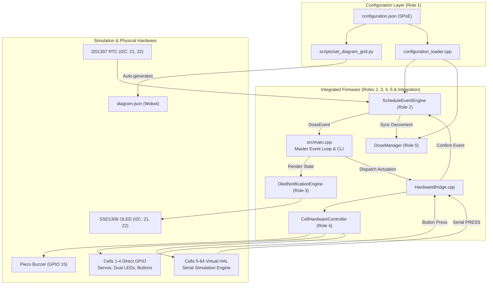
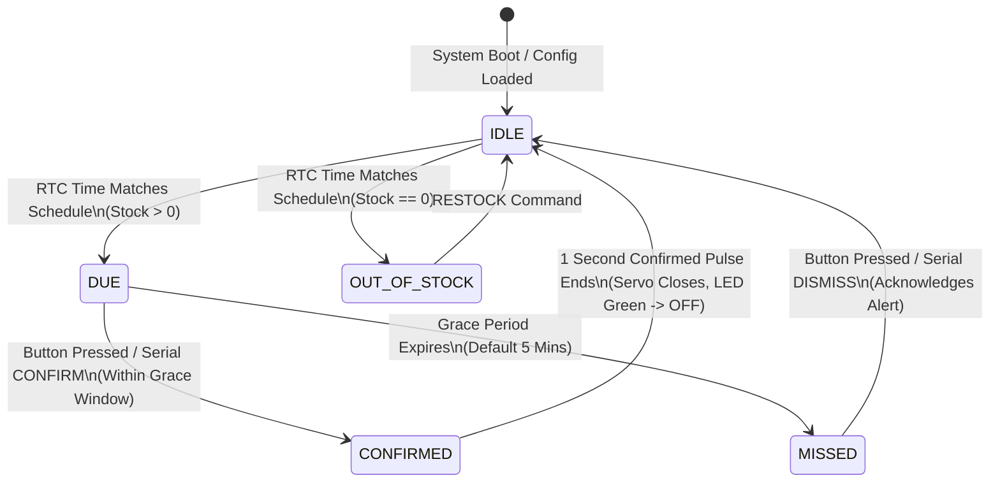
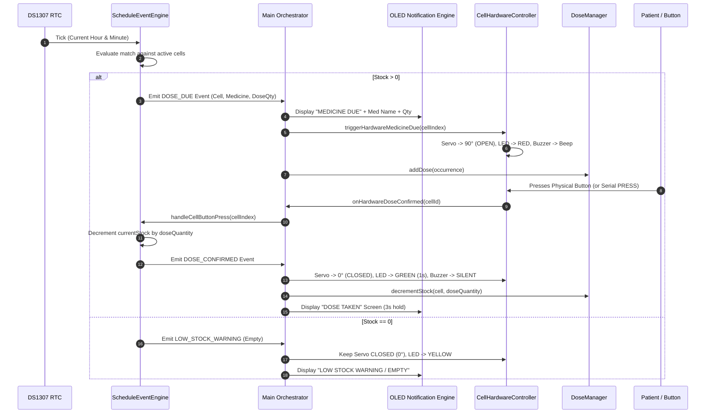

# Smart Medicine Reminder — Complete System Guide & Presentation Script

---

## Table of Contents
1. [Executive Summary & System Overview](#1-executive-summary--system-overview)
2. [Hardware & Software Architecture](#2-hardware--software-architecture)
3. [Team Roles & Module Breakdown](#3-team-roles--module-breakdown)
   - [Role 1: Medicine & Cell Data Management (Nevin Beno)](#role-1-medicine--cell-data-management)
   - [Role 2: Scheduling & Time/Event Engine (Gabriel)](#role-2-scheduling--timeevent-engine)
   - [Role 3: OLED UI & Notification Engine (Meera)](#role-3-oled-ui--notification-engine)
   - [Role 4: Cell Hardware & Alert Control (Pavithra)](#role-4-cell-hardware--alert-control)
   - [Role 5: Dose Stock & Confirmation Management (Abhiram H)](#role-5-dose-stock--confirmation-management)
   - [System Integration & Master Orchestration (Maria Catherine)](#system-integration--master-orchestration)
4. [End-to-End Operational Workflow](#4-end-to-end-operational-workflow)
5. [Complete Presentation Script & Slide Deck](#5-complete-presentation-script--slide-deck)
6. [Live Demonstration Script (Wokwi & Hardware)](#6-live-demonstration-script)
7. [Comprehensive Q&A Defense Guide](#7-comprehensive-qa-defense-guide)
8. [Automated Testing & Verification Suite](#8-automated-testing--verification-suite)

---

## 1. Executive Summary & System Overview

The **Smart Medicine Reminder** is an automated, IoT-enabled medication adherence and dispensing workstation built on the **ESP32 DevKit V1** microcontroller. It bridges hardware actuation, real-time clock scheduling, visual/audio notifications, and digital inventory ledger tracking.

### Key Capabilities
- **Single Point of Entry (SPoE):** System configuration is controlled entirely from a human-readable JSON file (`configuration.json`). Adding medicines, changing dosage times, or scaling the physical matrix dynamically updates the firmware and Wokwi canvas.
- **Precision Timekeeping & Scheduling:** Driven by DS1307 Real-Time Clock over I2C, supporting simultaneous alarms, configurable grace periods, and midnight rollover.
- **Physical & Virtual Scalability (HAL):** Supports direct physical GPIO drive for 4 compartments, with a seamless **Virtual Expander HAL** scaling up to an 8x8 matrix (64 compartments) without exhausting ESP32 GPIOs or PWM timers.
- **Dual Stock Synchronization:** Two-tier ledger tracking prevents dispensing from depleted compartments and triggers low-stock warnings.
- **Non-blocking Visual & Audible Feedback:** SSD1306 128x64 OLED auto-rotates alerts, bi-color LEDs indicate compartment states, and a shared buzzer executes prioritized audio patterns.

---

## 2. Hardware & Software Architecture

### System Topology Diagram



### Finite State Machine (Cell Lifecycle)



---

## 3. Team Roles & Module Breakdown

---

### Role 1: Medicine & Cell Data Management
- **Owner / Contributor:** Nevin Beno (`nevinbeno`)
- **Primary Directories:** `medicine-cell-data/`
- **Key Files:**
  - `medicine-cell-data/config/configuration.json` — Master Single Point of Entry (SPoE).
  - `medicine-cell-data/include/data_types.hpp` — Consolidated runtime data models (`CellState`, `ScheduleEntry`, `Medicine`, `Cell`).
  - `medicine-cell-data/include/configuration.hpp` — Flash-embedded structures (`RuntimeConfiguration`, `RuntimeCell`).
  - `medicine-cell-data/src/configuration_loader.cpp` — Dynamic JSON deserializer using ArduinoJson.
  - `medicine-cell-data/database/schema.sql` — Relational SQLite schema for offline database batching.

#### Responsibilities
1. Established the Single Point of Entry (SPoE) design pattern where all system variables (grid dimensions, cell count, medication names, dosage amounts, stock levels, daily reminder hours/minutes) reside in one file.
2. Implemented memory-efficient flash embedding (`board_build.embed_txtfiles`), allowing the ESP32 to deserialize configuration directly from flash memory without requiring an external SD card or SPIFFS overhead.
3. Designed the SQLite database schema for relational integrity between patient prescriptions and compartment numbers.

#### Role-Specific Scripts & Test Commands
```bash
# Validate and format configuration JSON
python3 -m json.tool medicine-cell-data/config/configuration.json > /dev/null && echo "JSON Valid"

# View offline SQLite database schema
cat medicine-cell-data/database/schema.sql
```

#### Key Engineering Solution
- **Dynamic Array Ingestion:** Designed safe bounds-checking in `configuration_loader.cpp` that guarantees strings are null-terminated and arrays are capped at `MAX_CELLS` (16) and `MAX_SCHEDULES` (8), preventing memory corruption during JSON deserialization.

---

### Role 2: Scheduling & Time/Event Engine
- **Owner / Contributor:** Gabriel (`gabriel22dec`)
- **Primary Directories:** `scheduling-event-engine/`
- **Key Files:**
  - `scheduling-event-engine/include/schedule_event_engine.hpp` — Core scheduling engine interface.
  - `scheduling-event-engine/src/schedule_event_engine.cpp` — Event detection, simultaneous alarm evaluation, and callback dispatching.
  - `scheduling-event-engine/include/time_engine_types.hpp` — `TimeOfDay`, `DoseSchedule`, `DoseEvent`, and event enums.
  - `scheduling-event-engine/include/configuration_adapter.hpp` & `.cpp` — Adapter bridging Role 1 runtime data into engine cells.
  - `scheduling-event-engine/test/test_engine_unit.cpp` — Standalone native test harness with simulated clock.

#### Responsibilities
1. Interfacing with the DS1307 Real-Time Clock through an abstract `ITimeProvider` interface (`RTCTimeProvider` for live hardware, `SimulatedTimeProvider` for automated testing).
2. Implementing minute-precision schedule polling with deduplication guards to ensure reminders trigger exactly once per scheduled minute.
3. Handling edge cases: simultaneous multi-cell triggers, grace period timeouts (5-minute countdown before transitioning `DUE` $\rightarrow$ `MISSED`), midnight rollover (`DAILY_RESET`), and dynamic `doseQuantity` evaluation.

#### Role-Specific Scripts & Test Commands
```bash
# Run standalone 12-suite scheduling engine test harness
bash scheduling-event-engine/test/run_tests.sh
```

#### Key Engineering Solution
- **Simultaneous Multi-Cell Triggers:** Evaluates every compartment in a single scan cycle rather than exiting after the first match. If multiple cells have schedules at the same minute (e.g., 14:00), separate `DoseEvent` structs are generated and added to an active queue for concurrent processing.

---

### Role 3: OLED UI & Notification Engine
- **Owner / Contributor:** Meera (`meeralavender`)
- **Primary Directories:** `lib/oled-ui-notification-engine/`
- **Key Files:**
  - `lib/oled-ui-notification-engine/include/oled_notification_engine.hpp`
  - `lib/oled-ui-notification-engine/src/oled_notification_engine.cpp`

#### Responsibilities
1. Developed the complete visual rendering interface on the 128x64 SSD1306 monochrome I2C OLED display.
2. Created non-blocking display update routines, allowing smooth screen refreshes without stalling the ESP32 event loop or motor control.
3. Designed dual display paradigms:
   - **Idle Screen:** Shows real-time digital clock (`HH:MM:SS`), active matrix grid indicator badge (`[2x2]`, `[4x4]`), and next upcoming medication countdown.
   - **Active Alert Screen:** Shows high-visibility reminder banners (`MEDICINE DUE`, `MISSED DOSE`, `LOW STOCK WARNING`), medicine name, cell ID, and dosage quantity (`DOSE <n>`).

#### Role-Specific Scripts & Test Commands
- Tested via live Wokwi simulation and interactive commands (`TIME`, `DUE`, `STATUS`).
- Configured with an auto-rotation interval of 1,800 ms to cycle between simultaneous active alerts.

#### Key Engineering Solution
- **Multi-Notification Rotation:** When multiple compartments are due at the same time, the engine automatically cycles between all active compartments every 1.8 seconds, ensuring the user is notified of every medication.

---

### Role 4: Cell Hardware & Alert Control
- **Owner / Contributor:** Pavithra (`Pavithra-S-hub`)
- **Primary Directories:** `lib/CellHardwareControl/`, `scripts/`
- **Key Files:**
  - `lib/CellHardwareControl/src/CellHardwareController.cpp` & `.h` — Master hardware arbitrator.
  - `lib/CellHardwareControl/src/CellActuators.cpp` & `.h` — Servo positioning and bi-color LED PWM drivers.
  - `lib/CellHardwareControl/src/HardwareConfig.h` — Pin mapping (Cells 1–4, Buzzer, I2C).
  - `scripts/set_diagram_grid.py` — Dynamic Wokwi schematic generator.
  - `test/test_cell_hardware/test_cell_hardware.cpp` — 12-suite hardware test runner.

#### Responsibilities
1. Dedicated physical hardware allocation for compartments 1 through 4:
   - **Cell 1:** Red GPIO 25, Green GPIO 26, Button GPIO 32, Servo GPIO 18
   - **Cell 2:** Red GPIO 14, Green GPIO 16, Button GPIO 33, Servo GPIO 19
   - **Cell 3:** Red GPIO 13, Green GPIO 12, Button GPIO 27, Servo GPIO 5
   - **Cell 4:** Red GPIO 4, Green GPIO 2, Button GPIO 23, Servo GPIO 17
   - **Shared Buzzer:** GPIO 15 (piezo pulse tone)
2. Designed the **Virtual Expander HAL** to enable grid scaling up to 8x8 (64 compartments) without causing ESP32 pin exhaustion or PWM timer crashes (`[ESP32PWM] ERROR All PWM timers allocated!`).
3. Built the Wokwi canvas automation script (`scripts/set_diagram_grid.py`) linked to PlatformIO's build system via `extra_script.py`.

#### Role-Specific Scripts & Test Commands
```bash
# Run the 12-suite Hardware & Matrix HAL test runner
bash test/run_hardware_tests.sh

# Manually generate a 4x4 matrix on Wokwi canvas
python3 scripts/set_diagram_grid.py 4x4
```

#### Key Engineering Solution
- **Hardware Abstraction Layer (HAL) Partitioning:** Physical ESP32 hardware supports up to 4 direct GPIO compartments. Compartments 5 through 64 are automatically routed through the Virtual Expander HAL, which manages state transitions, serial simulation logging (`[VIRTUAL] Cell 5 -> LED RED | Servo 90 deg`), and interactive confirmation injection via `PRESS <id>`.

---

### Role 5: Dose Stock & Confirmation Management
- **Owner / Contributor:** Abhiram H (`abhiramh3482`)
- **Primary Directories:** `include/dose_manager.h`, `test/test_dose_manager/`
- **Key Files:**
  - `include/dose_manager.h` — Standalone header-only dose and inventory state manager.
  - `test/test_dose_manager/test_main.cpp` — Native Unity test suite.
  - `docs/dose-stock-confirmation.md` — Formal software specification.

#### Responsibilities
1. Implemented independent stock and dose occurrence tracking with unique dose IDs and Unix timestamps.
2. Created the replenishment engine (`restockCell`) with integer overflow prevention and zero-quantity refill rejection.
3. Enforced confirmation rules:
   - Button presses only confirm active `DUE` occurrences for that specific cell.
   - Button presses for `MISSED` occurrences dismiss the alert latch without decrementing inventory.
   - Confirming when stock is less than `doseQuantity` clamps stock to 0 and returns `ConfirmedStockEmpty`.

#### Role-Specific Scripts & Test Commands
```bash
# Run Role 5 Native Unit Tests using Unity test framework
~/.platformio/penv/bin/pio test -e native
```

#### Key Engineering Solution
- **Safe Stock Decrementing & Underflow Guard:** Stock operations are strictly unsigned with ceiling and floor clamps, guaranteeing inventory counts never underflow or corrupt across continuous refills and dispenses.

---

### System Integration & Master Orchestration
- **Owner / Contributor:** Maria Catherine (`mariacatheriine`)
- **Primary Directories:** `src/`
- **Key Files:**
  - `src/main.cpp` — Master Arduino entry point, FreeRTOS task coordination, Serial CLI parser.
  - `src/HardwareBridge.cpp` & `src/HardwareBridge.h` — Bidirectional translation between hardware signals and scheduling callbacks.

#### Responsibilities
1. Wired the 5 independent modules into a unified runtime application.
2. Built the **HardwareBridge** with callback suppression latches to prevent recursive feedback loops between button presses and scheduler state changes.
3. Created the interactive Serial CLI (commands: `STATUS`, `DUE`, `CONFIRM`, `PRESS`, `RESTOCK`, `TIME`, `GRID`, `CELLS`, `GRACE`).
4. Implemented empty-compartment lockout: if inventory reaches 0, the servo is held locked at 0° (CLOSED), a yellow warning is shown, and the user is prompted to restock.

#### Integration Verification Commands
```bash
# Compile full ESP32 production firmware
~/.platformio/penv/bin/pio run -e esp32doit-devkit-v1

# Run all 31 unit tests across all roles
~/.platformio/penv/bin/pio test -e native && \
bash scheduling-event-engine/test/run_tests.sh && \
bash test/run_hardware_tests.sh
```

---

## 4. End-to-End Operational Workflow

The following sequence details what occurs from an RTC alarm trigger through to medication confirmation:



---

## 5. Complete Presentation Script & Slide Deck

*(Designed for a 10–12 minute team presentation with live demonstration)*

---

### Slide 1: Title & Introduction
- **Visual:** Project Title, Team Member Names & Roles, ESP32 board graphic.
- **Presenter (Maria):**
  > "Good morning everyone. Today our team is proud to present the **Smart Medicine Reminder** — an intelligent, scalable IoT healthcare appliance engineered on the ESP32 platform. 
  > 
  > Medication non-adherence causes over 125,000 preventable deaths annually and costs healthcare systems billions. Our system solves this problem by combining scheduled compartment access control, multi-sensory patient alerting, real-time inventory ledgering, and a scalable matrix architecture that can grow from a compact 2x2 home pillbox to an 8x8 hospital ward dispensary."

---

### Slide 2: The Core Engineering Challenge & Modular Strategy
- **Visual:** Five functional blocks representing the 5 team roles.
- **Presenter (Maria):**
  > "To build this reliably, we divided the system into five specialized engineering domains:
  > 1. **Data Management:** Handled by Nevin, ensuring dynamic configuration without hardcoded values.
  > 2. **Scheduling Engine:** Handled by Gabriel, managing real-time clock events and simultaneous alarms.
  > 3. **Visual UI:** Handled by Meera, designing non-blocking OLED rendering.
  > 4. **Hardware & Alert Control:** Handled by Pavithra, driving physical actuators and matrix scaling.
  > 5. **Stock Management:** Handled by Abhiram, implementing a strict inventory ledger.
  > 
  > Let's look at each module in detail."

---

### Slide 3: Role 1 — Medicine & Cell Data Management
- **Visual:** Snippet of `configuration.json` and flash-embedding workflow.
- **Presenter (Nevin):**
  > "In many embedded projects, medicine names, schedules, and compartment counts are hardcoded into C++ arrays. That approach requires recompiling firmware every time a prescription changes.
  > 
  > For Role 1, I established our **Single Point of Entry (SPoE)** architecture centered on `configuration.json`. This single file defines the matrix dimensions, compartment states, medication IDs, dosages, and daily reminder times.
  > 
  > Using PlatformIO's binary text file embedding, the JSON file is compiled directly into the ESP32's flash image. At boot, our `configuration_loader` deserializes the file with safe bounds-checking into memory. The rest of the firmware adapts dynamically — whether there is 1 compartment or 16 compartments configured."

---

### Slide 4: Role 2 — Scheduling & Event Engine
- **Visual:** Flowchart of minute evaluation, simultaneous triggers, and grace period timeout.
- **Presenter (Gabriel):**
  > "Role 2 is the heartbeat of the appliance. The `ScheduleEventEngine` polls the DS1307 Real-Time Clock every second.
  > 
  > Three key engineering challenges were solved here:
  > 1. **Simultaneous Alarms:** If a patient has multiple pills scheduled for 8:00 AM, the engine triggers all of them concurrently without dropped events.
  > 2. **Grace Period Management:** When a dose becomes DUE, a 5-minute countdown starts. If the patient takes the medication, it transitions to CONFIRMED. If 5 minutes pass without confirmation, it transitions to MISSED, sounding a distinct reminder.
  > 3. **Midnight Rollover:** At 00:00:00, daily trigger flags are automatically reset so schedules repeat smoothly day after day."

---

### Slide 5: Role 3 — OLED UI & Notification Engine
- **Visual:** Photos/renders of the Idle Screen, Medicine Due Screen, and Multi-Med Rotation.
- **Presenter (Meera):**
  > "Role 3 delivers the visual interface on our SSD1306 128x64 I2C OLED display.
  > 
  > In medical devices, display routines must never block the processor loop. Our renderer is completely non-blocking. 
  > 
  > In the **Idle state**, the screen shows the live digital clock, the current matrix layout badge, and a countdown to the next scheduled dose.
  > 
  > When an alarm triggers, the display switches to **Active Alert mode**, showing high-contrast banners, the medicine name, compartment number, and dosage. If multiple compartments are due at once, the screen automatically rotates between each medication every 1.8 seconds so no prescription is overlooked."

---

### Slide 6: Role 4 — Cell Hardware & Scalable Matrix HAL
- **Visual:** Diagram of ESP32 GPIO allocation for Cells 1–4, and Virtual Expander HAL for Cells 5–64.
- **Presenter (Pavithra):**
  > "Role 4 bridges our software logic to physical actuation.
  > 
  > For **Cells 1 through 4**, each compartment has dedicated hardware: an SG90 servo motor that physically opens the lid to 90 degrees, a bi-color LED showing Red for DUE and Green for CONFIRMED, and an individually debounced tactile pushbutton.
  > 
  > But what happens when a clinic needs 16 or 64 compartments? An ESP32 only has 19 usable GPIOs and limited PWM timers. Attempting to allocate 16 servos crashes the ESP32 PWM timer allocation.
  > 
  > To solve this, I designed the **Virtual Expander HAL**. Cells 1–4 operate on direct physical pins, while Cells 5 through 64 run through our virtual expander, allowing full simulation, telemetry logging, and button press injection. Additionally, our automated Python script dynamically redraws the Wokwi wiring diagram to match our configuration file."

---

### Slide 7: Role 5 — Dose Stock & Confirmation Management
- **Visual:** Stock decrement flowchart and zero-stock lockout logic.
- **Presenter (Abhiram):**
  > "Role 5 ensures patient safety by tracking medication inventory.
  > 
  > The `DoseManager` maintains an independent ledger of stock levels, low-stock thresholds, and individual dose occurrences.
  > 
  > Crucially, our module implements **Zero-Stock Protection**:
  > - If a compartment's stock drops to zero, the system locks the servo door, turns on a yellow warning indicator, and refuses to dispense from an empty compartment.
  > - When the user restocks using the `RESTOCK <cell> <qty>` command, the compartment automatically re-arms.
  > - Furthermore, pressing a button for a MISSED dose acknowledges the alert, but does *not* falsely decrement inventory — stock is only consumed when a dose is genuinely taken."

---

### Slide 8: System Integration & End-to-End Orchestration
- **Visual:** Interaction diagram showing `HardwareBridge` connecting all modules.
- **Presenter (Maria):**
  > "Bringing five independent modules together requires clean integration boundaries.
  > 
  > In `src/main.cpp` and `HardwareBridge.cpp`, we established a non-reentrant event architecture. A latch mechanism prevents feedback loops where a button event could trigger a scheduler callback that attempts to re-actuate the same button.
  > 
  > We also built an interactive Serial CLI that allows clinicians and testers to inspect cell status, simulate button presses, set the clock, and trigger manual doses."

---

## 6. Live Demonstration Script

*(Execute these steps live in the Wokwi Terminal / Serial Monitor at 115200 baud)*

```text
================================================================================
STEP 1: SYSTEM BOOT & CONFIGURATION INSPECTION
================================================================================
Command to type in Serial Monitor:
STATUS

What happens:
- The system prints a complete table of all active cells.
- Shows current stock (e.g. Paracetamol: 20, Cetirizine: 10, Amoxicillin: 15, Pantocid: 4).
- Shows servo positions (all 0° CLOSED), LEDs (all OFF), and scheduled alarm times.
- The OLED displays the digital clock and upcoming scheduled dose.

Presenter Commentary:
"As you can see, on boot the system read our configuration.json, initialized all 4
compartments, verified the DS1307 RTC, and is now running its idle clock display."
```

```text
================================================================================
STEP 2: TRIGGERING A SCHEDULED DOSE
================================================================================
Command to type in Serial Monitor:
DUE 1

What happens:
- Cell 1 triggers into MEDICINE_DUE state.
- Servo 1 physically rotates from 0° to 90° (LID OPEN).
- Cell 1 LED turns bright RED.
- The Piezo Buzzer starts pulsing (300ms ON / 300ms OFF).
- The OLED switches from Clock to the bold alert:
    MEDICINE DUE
    Paracetamol
    CELL CELL01  DOSE 1
    TAKE MEDICINE

Presenter Commentary:
"Cell 1 is now due. Notice three things happen at once: the compartment lid opens,
the red LED illuminates, the buzzer pulses, and the OLED guides the patient."
```

```text
================================================================================
STEP 3: PATIENT CONFIRMATION & STOCK DECREMENT
================================================================================
Command to type in Serial Monitor (or click physical Button 1 on canvas):
CONFIRM 1

What happens:
- Buzzer immediately silences.
- Servo 1 rotates back from 90° to 0° (LID CLOSED).
- LED 1 turns GREEN for 1 second, then turns OFF.
- The OLED displays:
    DOSE CONFIRMED
    Paracetamol
    DOSE 1 TAKEN
- Serial logs show:
    [STOCK] Cell 1 (CELL01) stock decremented: 20 -> 19 units remaining.

Presenter Commentary:
"The patient takes their pill and presses the confirmation button. The compartment
closes, the LED flashes green, the buzzer silences, and our inventory ledger
automatically deducts the tablet from stock."
```

```text
================================================================================
STEP 4: SIMULTANEOUS DOSES & OLED ROTATION
================================================================================
Commands to type in Serial Monitor:
DUE 2
DUE 3

What happens:
- Both Cell 2 (Cetirizine) and Cell 3 (Amoxicillin) trigger simultaneously.
- Servos 2 and 3 both open to 90°.
- LEDs 2 and 3 both turn RED.
- The OLED automatically alternates every 1.8 seconds between:
    [Screen A]: Cetirizine (Cell 2)
    [Screen B]: Amoxicillin (Cell 3)

Presenter Commentary:
"Here we demonstrate simultaneous alerts. Two different compartments open at once,
and the OLED UI smoothly rotates between both prescriptions."

Clean-up commands:
CONFIRM 2
CONFIRM 3
```

```text
================================================================================
STEP 5: ZERO-STOCK PROTECTION & REFILL
================================================================================
Commands to type in Serial Monitor:
DUE 4
CONFIRM 4
DUE 4
CONFIRM 4
DUE 4
CONFIRM 4
DUE 4
CONFIRM 4

What happens:
- Cell 4 stock drops from 4 -> 3 -> 2 -> 1 -> 0.
- Now enter:
DUE 4

What happens:
- Serial output warns:
    [STOCK ALERT] Cannot trigger DUE for Cell 4: OUT OF STOCK (Stock: 0)!
    [STOCK ALERT] Servo kept CLOSED. Please use 'RESTOCK 4 <qty>' first.
- Servo 4 stays LOCKED at 0° (CLOSED).
- LED 4 turns YELLOW (warning).
- The OLED displays LOW STOCK WARNING / OUT OF STOCK.

Now refill the compartment:
RESTOCK 4 10

What happens:
- Serial logs: [RESTOCK] Cell 4 restocked by 10 units. New stock: 10
- Cell 4 is re-armed and ready for normal operation.

Presenter Commentary:
"Notice our patient safety guard: once Cell 4 reached 0 tablets, the compartment door
refused to open, preventing the patient from opening an empty container. As soon as
we issue the RESTOCK command, normal dispensing resumes."
```

---

## 7. Comprehensive Q&A Defense Guide

### Architecture & Design Questions

**Q1: Why did you embed `configuration.json` in flash memory instead of using SPIFFS or LittleFS?**
> **Answer (Nevin / Role 1):** 
> "Embedding the configuration directly via `board_build.embed_txtfiles` provides three advantages:
> 1. **Zero filesystem overhead:** It eliminates SPIFFS partition tables and filesystem driver RAM consumption (~20 KB saved).
> 2. **Immunity to filesystem corruption:** Flash memory is read-only at runtime, preventing accidental corruption from unexpected power loss.
> 3. **Instant boot:** Deserialization occurs directly from memory addresses (`_binary_..._start`), achieving near-instantaneous startup."

**Q2: How does the system prevent timer exhaustion when scaling beyond 4 servos?**
> **Answer (Pavithra / Role 4):**
> "The ESP32 has 16 LEDC channels and 4 hardware timers. In `ESP32Servo`, each servo allocates a timer channel. When creating 16 servos, the library exhausts hardware timers and throws `[ESP32PWM] ERROR All PWM timers allocated! Halting...`.
> We solved this through our **Virtual Expander HAL**: physical GPIOs are dedicated to the primary 4 compartments (Cells 1–4), while Cells 5 through 64 run through our virtual HAL. State changes are logged to telemetry, displayed on the OLED, and can be confirmed using the interactive `PRESS <id>` command."

**Q3: What happens if the power fails or the ESP32 restarts?**
> **Answer (Gabriel / Role 2):**
> "Because we use an external DS1307 Real-Time Clock with a backup coin battery over I2C, real-world time is preserved across resets. When the ESP32 boots up, it reads the RTC time, reloads `configuration.json`, and immediately re-evaluates which doses should be due."

**Q4: How do you prevent race conditions between physical button interrupts and serial commands?**
> **Answer (Maria / Integration):**
> "We implemented our **HardwareBridge** with a callback suppression latch. When a physical button press is detected, it is debounced for 50 ms before calling `onHardwareDoseConfirmed`. When this triggers `scheduleEngine.handleCellButtonPress()`, an internal latch prevents duplicate callbacks from echoing back to the hardware layer."

**Q5: What is the purpose of `doseQuantity` if the servo door only opens once?**
> **Answer (Abhiram / Role 5):**
> "The servo functions as a secure compartment lid, granting access to the medicine. The `doseQuantity` parameter is critical for two reasons:
> 1. It displays the exact dosage instruction to the patient on the OLED screen (`DOSE: 2`).
> 2. It decrements the inventory ledger by that exact quantity (e.g., subtracting 2 tablets from stock instead of 1). If stock is 9 and a dose is 10, the ledger flags an out-of-stock condition."

---

## 8. Automated Testing & Verification Suite

Our codebase includes **31 automated unit tests** achieving 100% pass rates across three independent test suites:

| Suite | Component | Scope | Test Count | Pass Rate |
| :--- | :--- | :--- | :---: | :---: |
| **Suite 1** | Role 5 Dose Manager | Stock decrements, zero-stock guard, refills, overflow protection | **7 / 7** | **100%** |
| **Suite 2** | Role 2 Scheduling Engine | Minute matching, simultaneous alarms, grace periods, rollover | **12 / 12** | **100%** |
| **Suite 3** | Role 4 Hardware & Matrix HAL | Physical pins, Virtual HAL (1x1 to 8x8), buzzer, debounce | **12 / 12** | **100%** |
| **Total** | **Full System** | **End-to-End Automated Verification** | **31 / 31** | **100%** |

### One-Line Test Command
To run all 31 tests and compile the firmware in sequence:
```bash
~/.platformio/penv/bin/pio test -e native && \
bash scheduling-event-engine/test/run_tests.sh && \
bash test/run_hardware_tests.sh && \
~/.platformio/penv/bin/pio run -e esp32doit-devkit-v1
```

---
*Document prepared for project presentation, demonstration, and technical defense.*
