# Smart Medicine Reminder & Dispensing Workstation

[](https://platformio.org/)
[-brightgreen.svg)](test/run_all_tests.sh)
[](docs/system_integration.md)
[](LICENSE)

An intelligent, scalable IoT medication adherence and dispensing workstation engineered on the **ESP32 DevKit V1**. The workstation features Real-Time Clock (RTC) precision scheduling, multi-sensory patient alerting (SSD1306 OLED, bi-color LEDs, piezo buzzer), automated compartment servo actuation, and an inventory management ledger with empty-stock safety locks.

Developed as a microcontrollers project by students of the **Department of Computer Science and Engineering, Government Engineering College, Thrissur (GECT)**.

---

## Interactive Simulation Circuit

The complete workstation is fully simulated in [Wokwi](https://wokwi.com/) with live wiring to the ESP32 DevKit V1:

<p align="center">
  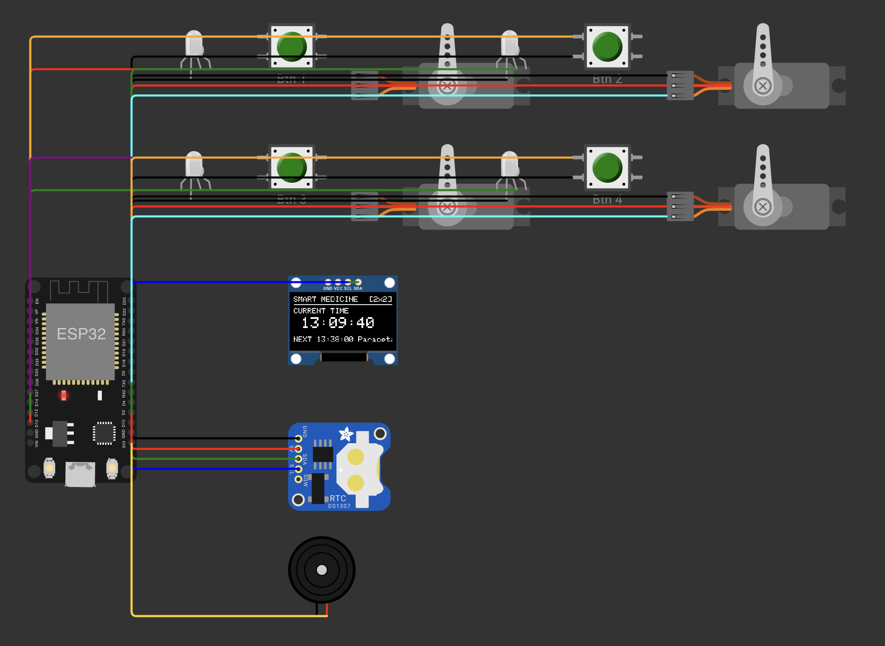
  <br>
  <em>Figure 1: Full interactive Wokwi simulation schematic showing ESP32 DevKit V1, SSD1306 OLED, DS1307 RTC, 4 SG90 servos, 4 bi-color LEDs, 4 pushbuttons, and piezo buzzer.</em>
</p>

---

## Team & Role Allocation

The system was developed under a modular, domain-driven architecture divided among 5 specialized roles and unified through a master system integration lead:

| Role | Domain / Module | Team Member | Reg. No. | GitHub Profile | Primary Deliverables |
| :--- | :--- | :--- | :---: | :--- | :--- |
| **Role 1** | **Medicine & Cell Data** | **Nevin Beno** | `TCR24CS052` | [@nevinbeno](https://github.com/nevinbeno) | Single Point of Entry (`configuration.json`), flash-embedded data loader (`board_build.embed_txtfiles`), SQLite relational schema. |
| **Role 2** | **Scheduling & Event Engine** | **Gabriel James** | `TCR24CS029` | [@gabsgj](https://github.com/gabsgj) | DS1307 RTC timekeeping, simultaneous dose triggers, 5-minute grace period, midnight rollover, standalone test engine (12 unit tests). |
| **Role 3** | **OLED UI & Notifications** | **Meera Nandita S.** | `TCR24CS045` | [@meeralavender](https://github.com/meeralavender) | SSD1306 128x64 OLED display driver, non-blocking UI, idle clock screen, 1.8s multi-alert carousel rotation. |
| **Role 4** | **Hardware & Alert Control** | **Pavithra S.** | `TCR24CS055` | [@PavithraSrajesh](https://github.com/PavithraSrajesh) | Dedicated GPIOs (Cells 1–4), SG90 servo drivers, bi-color LEDs, Virtual Expander HAL (Cells 5–64), dynamic Wokwi canvas generator. |
| **Role 5** | **Dose & Stock Management** | **Abhiram H.** | `TCR24CS002` | [@AbhiramH7](https://github.com/AbhiramH7) | Real-time dose inventory ledger, zero-stock dispense guard, low-stock threshold alerts, refill CLI API, native Unity test suite (7 tests). |
| **Role 6** | **Integration & Final Docs** | **Catherine Maria Benny** | `TCR24CS020` | [@mariacatheriine](https://github.com/mariacatheriine) | Master FreeRTOS loop (`main.cpp`), `HardwareBridge` latches, interactive Serial CLI, master test runner (33 tests), comprehensive technical documentation. |

---

## Visual Demonstration & System Walkthrough

### 1. OLED User Interface & Notification Display

The non-blocking SSD1306 128x64 I2C display dynamically shifts between system states:

| Idle Clock & Next Scheduled Dose | Medicine Due Alert |
| :---: | :---: |
| 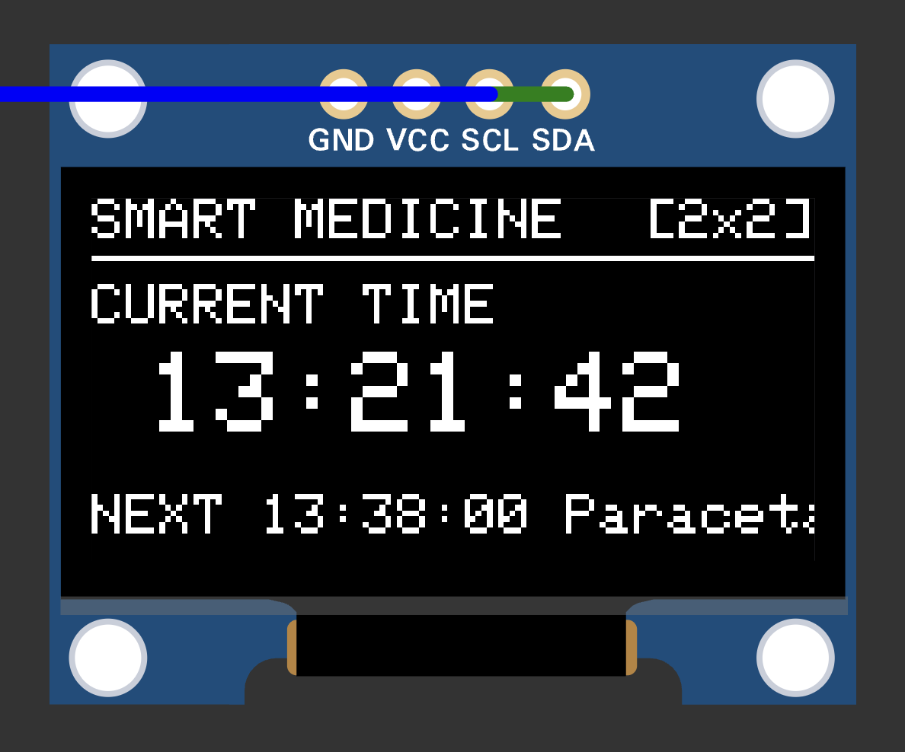 | 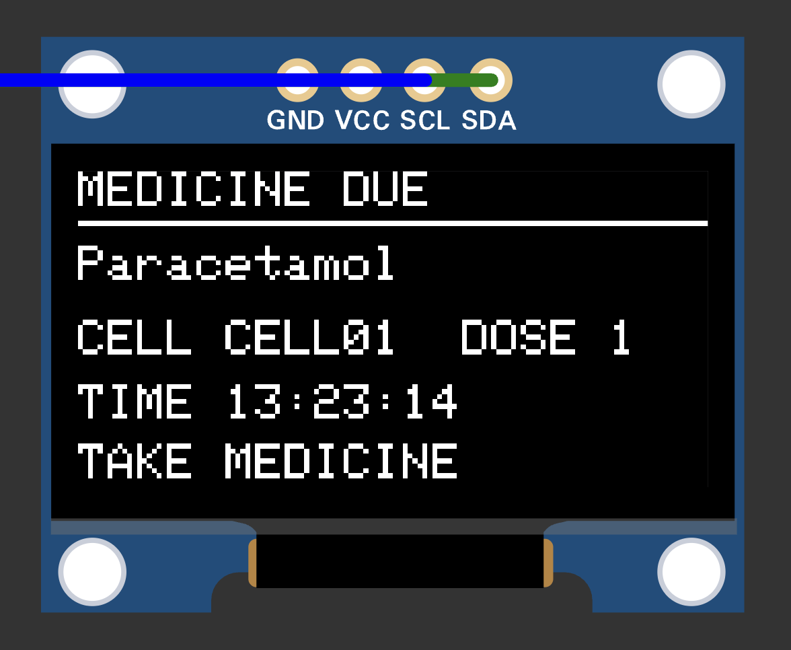 |
| *Title, `[2x2]` grid tag, live running clock (`HH:MM:SS`), and next scheduled reminder (`NEXT: 13:38`)* | *High-visibility alert showing medicine name, dosage, and compartment ID* |

| Dose Confirmed Acknowledgment | Multi-Alarm 1.8-Second Carousel |
| :---: | :---: |
| 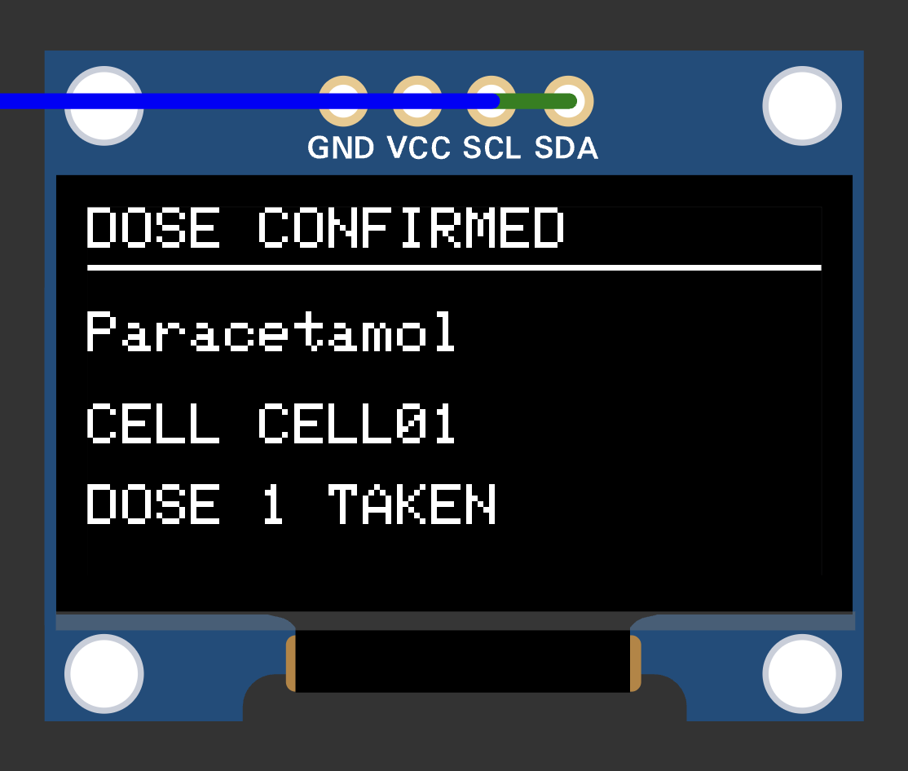 | 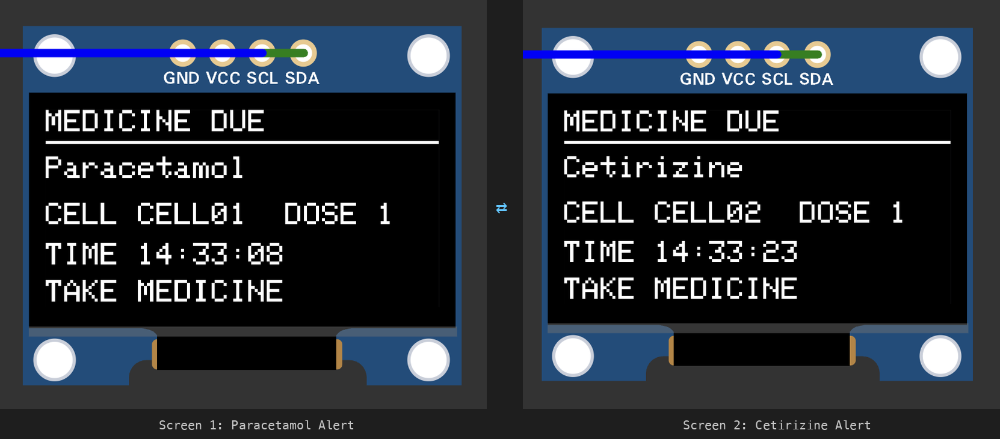 |
| *Immediate visual confirmation upon physical pushbutton press or serial `CONFIRM`* | *Smooth non-blocking alternating rotation when multiple compartments are due simultaneously* |

---

### 2. Compartment Hardware Actuation & Dispensing Lifecycle

Each physical compartment combines an SG90 servo door, a bi-color LED (Red/Green), and a tactile confirmation pushbutton:

| Compartment Due State (`DUE`) | Dose Confirmed State (`CONFIRMED`) |
| :---: | :---: |
| 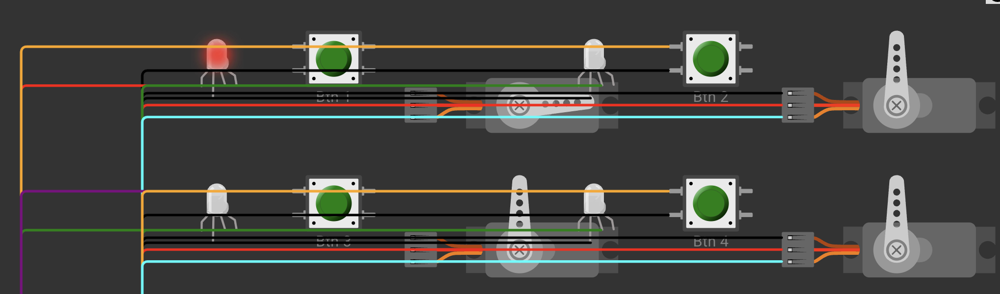 | 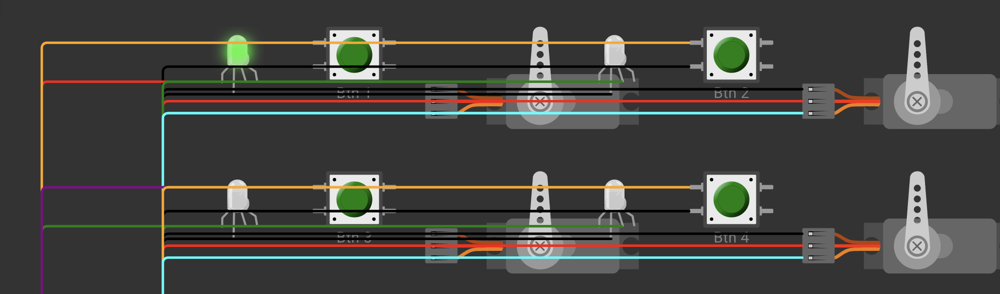 |
| **Servo opens to 90°**, red LED illuminates solid, piezo buzzer pulses audio alert. Other cells remain safely locked. | **Servo returns to 0° (CLOSED)**, LED flashes green for 1 second, buzzer silences, inventory ledger decrements. |

| Missed Dose Grace Expiration (`MISSED`) | RTC Automated Schedule Trigger |
| :---: | :---: |
| 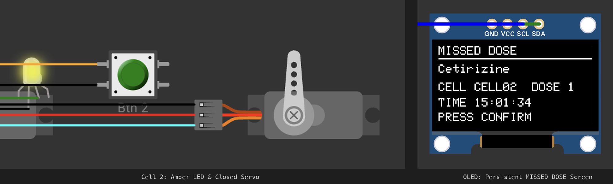 | 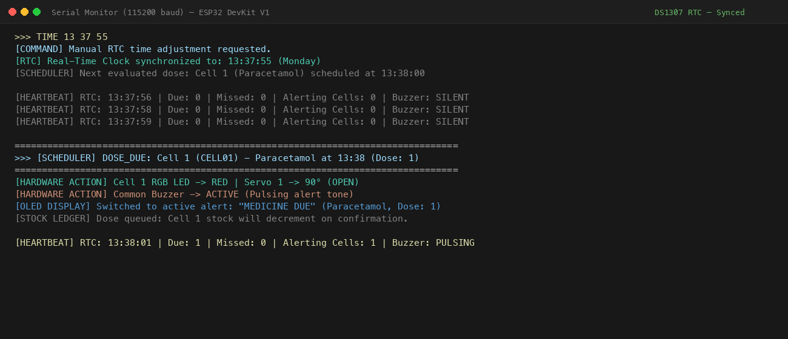 |
| 5-minute grace window elapses without acknowledgment: servo safely closes, **LED turns amber/yellow**, buzzer stops, OLED warns `MISSED DOSE`. | DS1307 RTC ticks past `13:38:00`: system automatically transitions Cell 1 to `DUE` without requiring external manual input. |

---

### 3. Inventory Ledger & Empty-Stock Safety Guard

The system enforces safety checks to prevent dry dispensing and ensure medication availability:

| Low Stock Warning | Zero-Stock Dispense Lockout | Restock & Re-Arming |
| :---: | :---: | :---: |
| 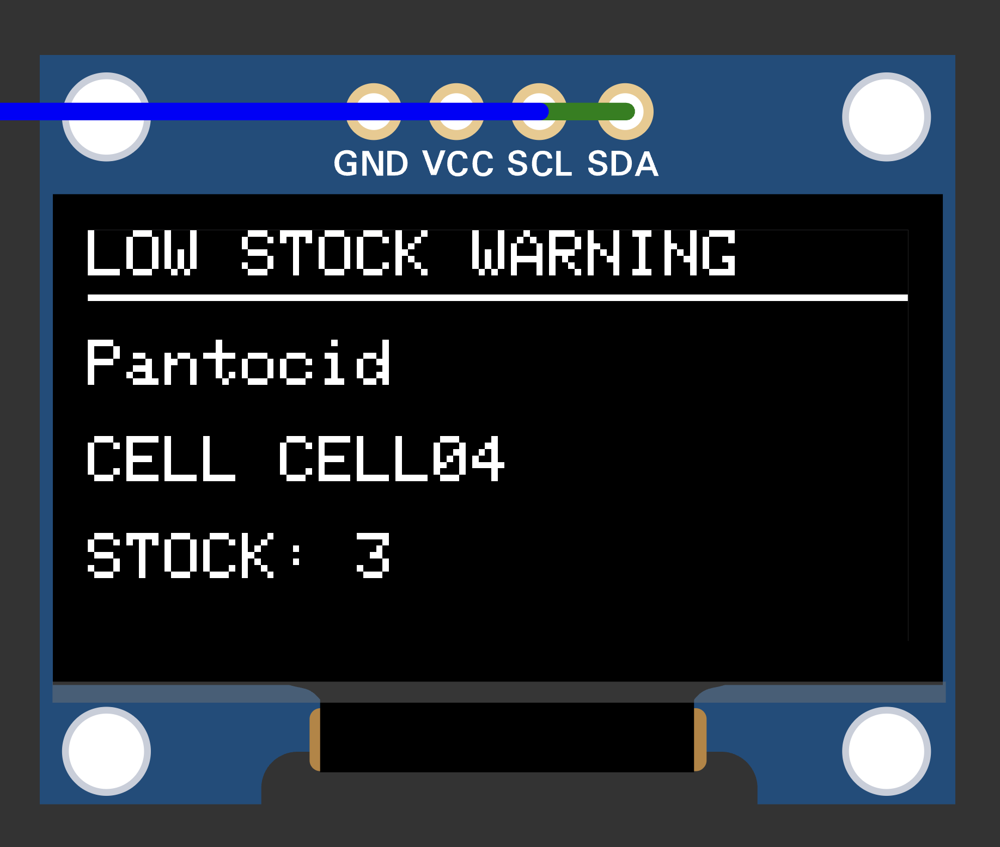 | 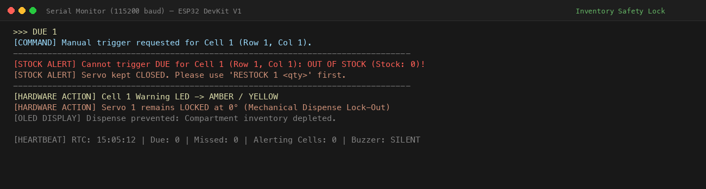 | 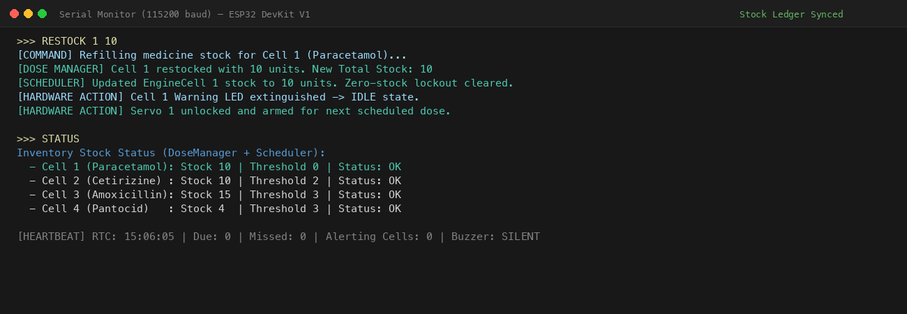 |
| Warning triggered when compartment inventory drops to/below threshold (`STOCK: 3`). | When inventory hits 0, scheduled dose is **refused**, servo remains locked at 0°, amber LED turns on, alert logged to UART. | `RESTOCK <cell> <qty>` restores inventory, clears lockout, extinguishes alert LED, and re-arms normal schedule. |

---

### 4. High-Capacity Scalability & Serial Telemetry

| Virtual Expander HAL (Cells 5–64) | Interactive Serial Terminal (`STATUS`) |
| :---: | :---: |
| 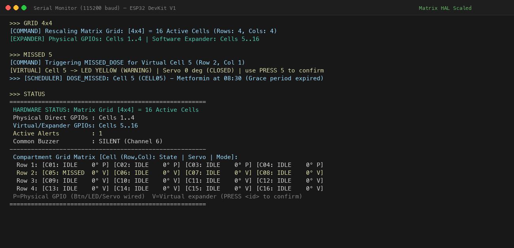 | 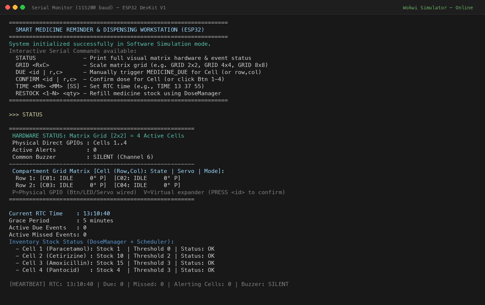 |
| Scalable matrix grid simulation for compartments 5 through 64 using virtual expansion HAL without consuming additional ESP32 GPIOs. | Live UART status table displaying grid layout, cell coordinates, servo positions, LED states, stock counts, and RTC clock. |

---

## System Architecture

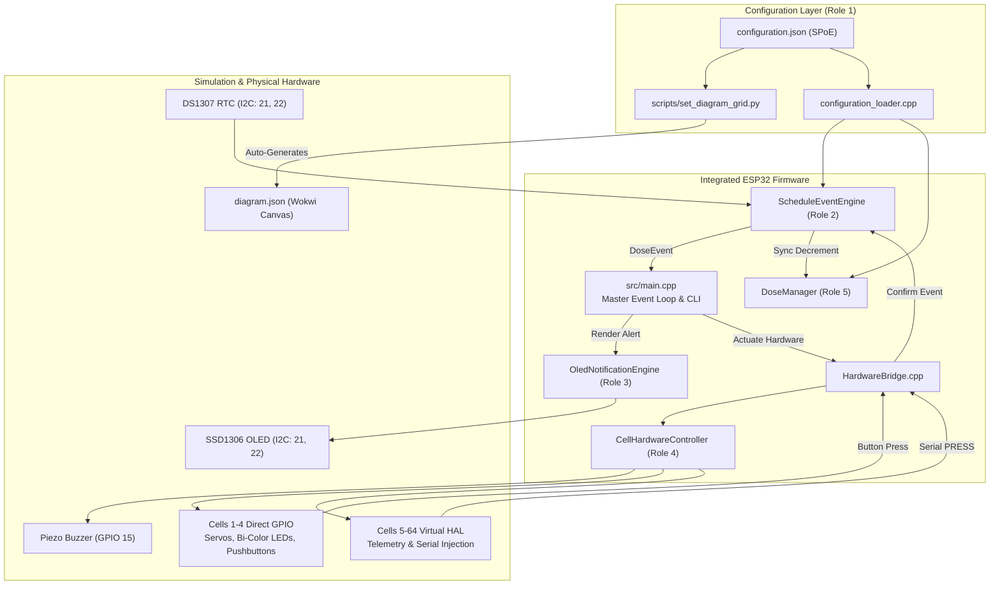

### Compartment Lifecycle State Machine

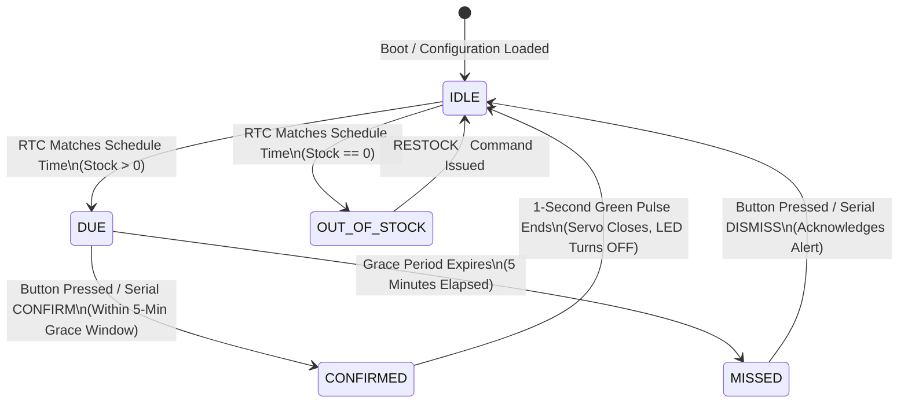

---

## Hardware Pinout (ESP32 DevKit V1)

Physical pins are mapped to the primary 4 compartments (Cells 1–4). Higher-capacity matrices (up to 8x8 / 64 compartments) scale seamlessly through the **Virtual Expander HAL**, avoiding GPIO pin exhaustion and PWM timer limits.

| Compartment | Red LED (DUE) | Green LED (CONFIRMED) | Push Button | SG90 Servo Motor | Description |
| :---: | :---: | :---: | :---: | :---: | :--- |
| **Cell 1** | `GPIO 25` | `GPIO 26` | `GPIO 32` | `GPIO 18` | Physical Compartment 1 |
| **Cell 2** | `GPIO 14` | `GPIO 16` (RX2) | `GPIO 33` | `GPIO 19` | Physical Compartment 2 |
| **Cell 3** | `GPIO 13` | `GPIO 12` | `GPIO 27` | `GPIO 5`  | Physical Compartment 3 |
| **Cell 4** | `GPIO 4`  | `GPIO 2`  | `GPIO 23` | `GPIO 17` (TX2) | Physical Compartment 4 |
| **Buzzer** | — | — | — | `GPIO 15` | Shared Piezo Alert Buzzer |
| **I2C Bus** | `GPIO 21` (SDA) | `GPIO 22` (SCL) | — | — | SSD1306 OLED & DS1307 RTC |
| **Cells 5–64**| *Virtual* | *Virtual* | `PRESS <id>` | *Virtual* | Virtual Expander HAL |

---

## Key Features

1. **Single Point of Entry (SPoE):**
   - Medication schedules, cell allocations, and matrix grid dimensions are configured centrally in [`medicine-cell-data/config/configuration.json`](medicine-cell-data/config/configuration.json).
   - PlatformIO's pre-build script ([`scripts/set_diagram_grid.py`](scripts/set_diagram_grid.py)) automatically synchronizes Wokwi's visual wiring diagram ([`diagram.json`](diagram.json)) on every build.
2. **Flash-Embedded Configuration:**
   - Configuration JSON is compiled directly into ESP32 flash memory (`board_build.embed_txtfiles`), eliminating filesystem (SPIFFS/LittleFS) overhead and startup latency.
3. **Dual Stock Ledgering & Empty Lockout:**
   - Real-time stock tracking synchronized across `ScheduleEventEngine` and `DoseManager`.
   - If stock reaches 0, the servo door remains locked at 0° (CLOSED), an amber alert illuminates, and empty dispensing is physically prevented until restocked.
4. **Non-Blocking Multi-Alarm OLED:**
   - 128x64 SSD1306 OLED refreshes asynchronously without blocking the FreeRTOS loop.
   - When multiple compartments trigger simultaneously, the display cycles between medications every 1.8 seconds.
5. **Virtual Matrix Scalability (1x1 to 8x8):**
   - Physical GPIOs power Cells 1–4; virtual expander HAL scales dynamically up to 64 compartments with CLI stimulation and telemetry.
6. **Interactive Serial CLI:**
   - Real-time control over simulated time, button presses, stock refills, and status inspection via UART0 at `115200` baud.

---

## Interactive Serial CLI Reference

Connect to the Serial Monitor at **115200 baud** to execute commands:

| Command | Syntax | Description | Example |
| :--- | :--- | :--- | :--- |
| **STATUS** | `STATUS` | Dumps real-time table of all active cells (Stock, Servos, LEDs, Schedules, RTC). | `STATUS` |
| **DUE** | `DUE <cell>` | Manually triggers a compartment into the `DUE` state (respects `doseQuantity`). | `DUE 1` |
| **CONFIRM** | `CONFIRM <cell>` | Simulates confirming a dose for an active compartment. | `CONFIRM 1` |
| **PRESS** | `PRESS <cell>` | Simulates pressing the physical pushbutton (works for Cells 1 to 64). | `PRESS 3` |
| **RESTOCK** | `RESTOCK <cell> <qty>` | Replenishes stock for a compartment and clears empty warnings. | `RESTOCK 4 10` |
| **TIME** | `TIME <HH> <MM> [SS]` | Sets the DS1307 simulated Real-Time Clock time. | `TIME 13 37 55` |
| **GRID** | `GRID <rows> <cols>` | Dynamically scales the hardware matrix dimensions (up to 8x8). | `GRID 4 4` |
| **GRACE** | `GRACE <minutes>` | Configures the grace period before an unanswered dose becomes `MISSED`. | `GRACE 10` |

---

## Automated Verification Suite (33 / 33 Tests Passing)

The project includes **33 automated unit tests with a 100% pass rate** across three independent test suites:

<p align="center">
  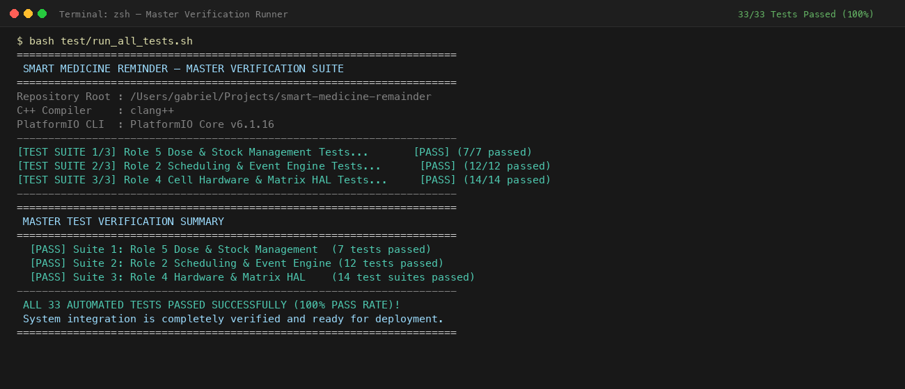
  <br>
  <em>Figure 2: Master test runner (`test/run_all_tests.sh`) executing all 33 unit tests with 100% pass rate across native Unity, standalone scheduler, and hardware HAL suites.</em>
</p>

### Running All Tests in One Command
```bash
bash test/run_all_tests.sh
```

### Breakdown of Test Suites

| Suite | Component / Module | Test File / Runner | Cases | Pass Rate | Validated Behaviors |
| :---: | :--- | :--- | :---: | :---: | :--- |
| **1** | **Role 5 Dose & Stock Manager** | `test/test_dose_manager/test_main.cpp` (Unity) | **7** | **100%** | Single dose decrements, missed dose stock preservation, wrong-cell rejection, multi-dose separate confirmation, underflow prevention, restock threshold clearing, duplicate/invalid ID rejection. |
| **2** | **Role 2 Scheduling Engine** | `scheduling-event-engine/test/run_tests.sh` (C++) | **12** | **100%** | Minute matching, simultaneous multi-dose triggers, dose confirmation, grace period expiry, missed dose dismissal, duplicate trigger suppression, midnight rollover daily reset, 16-cell scalability, SPoE adapter loading, next scheduled dose calculation, zero-stock lockout & refill. |
| **3** | **Role 4 Hardware & Matrix HAL** | `test/run_hardware_tests.sh` (Native C++) | **14** | **100%** | Physical 4-cell GPIO pin state transitions, servo PWM angle arbitration (0°/90°), bi-color LED states, button debounce, buzzer state arbitration, dynamic 1x1 through 8x8 virtual matrix scalability. |

<p align="center">
  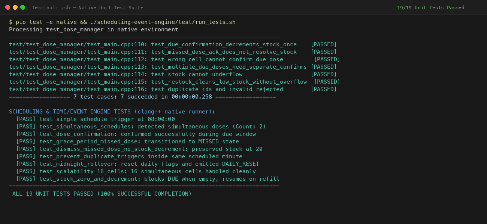
  <br>
  <em>Figure 3: Standalone Scheduling Engine Unit Tests (Role 2) verifying all 12 timekeeping and event scenarios.</em>
</p>

---

## Getting Started & Wokwi Simulation

### Prerequisites
- [Visual Studio Code](https://code.visualstudio.com/)
- [PlatformIO IDE Extension](https://marketplace.visualstudio.com/items?itemName=platformio.platformio-ide)
- [Wokwi Simulator Extension](https://marketplace.visualstudio.com/items?itemName=Wokwi.wokwi-vscode)

### Running the Project
1. **Clone the repository:**
   ```bash
   git clone https://github.com/nevinbeno/smart-medicine-remainder.git
   cd smart-medicine-remainder
   ```
2. **Build the firmware using PlatformIO:**
   ```bash
   pio run -e esp32doit-devkit-v1
   ```
3. **Launch the Wokwi Simulation:**
   - Open `diagram.json` in VS Code.
   - Click the green **Play** button in the simulation canvas.
4. **Open the Serial Monitor:**
   - Connect at **115200 baud**.
   - Type `STATUS` to view live compartment status, or `TIME 13 37 55` to watch an automated dose trigger at 13:38!

---

## Detailed Presentation & Defense Guide

For the full slide-by-slide spoken script, live demo walkthrough, and technical Q&A defense answers, consult:
📄 **[PROJECT_GUIDE.md](PROJECT_GUIDE.md)**

---

## Repository Structure

```text
.
├── diagram.json                       # Wokwi canvas schematic (auto-synced)
├── grid_config.json                   # Active matrix grid layout metadata
├── platformio.ini                     # Build environments (ESP32 DevKit V1 & Native Unity)
├── extra_script.py                    # PlatformIO SCons pre-build hook for SPoE auto-sync
├── README.md                          # Official project documentation & visual gallery
├── PROJECT_GUIDE.md                   # Complete presentation script & technical defense guide
├── LICENSE                            # MIT License
├── medicine-cell-data/                # Role 1: Data Models & SPoE Configuration (Nevin)
│   ├── config/configuration.json      # Master Single Point of Entry configuration
│   ├── database/schema.sql            # Relational SQLite prescription schema
│   ├── include/                       # Runtime configuration & data types
│   └── src/configuration_loader.cpp   # Flash JSON deserializer
├── scheduling-event-engine/           # Role 2: Timekeeping & Scheduling Engine (Gabriel)
│   ├── include/                       # ScheduleEventEngine & TimeProvider interfaces
│   ├── src/schedule_event_engine.cpp  # Alarm matching, simultaneous events, grace period
│   └── test/run_tests.sh              # 12-suite standalone scheduler test runner
├── lib/oled-ui-notification-engine/   # Role 3: SSD1306 OLED Display Driver (Meera)
│   ├── include/                       # OledNotificationEngine interface
│   └── src/oled_notification_engine.cpp # Non-blocking clock, alerts, 1.8s auto-rotation
├── lib/CellHardwareControl/           # Role 4: Physical Actuators & Virtual Expander HAL (Pavithra)
│   ├── src/CellHardwareController.cpp # Master hardware arbitrator & state machine
│   ├── src/CellActuators.cpp          # SG90 Servos & Bi-Color LED drivers
│   └── src/HardwareConfig.h           # Physical GPIO pin allocations
├── include/dose_manager.h             # Role 5: Inventory Ledger & Safety Logic (Abhiram)
├── scripts/set_diagram_grid.py        # Automation: Dynamic Wokwi diagram generator
├── src/                               # Role 6: Master System Integration (Catherine)
│   ├── main.cpp                       # Master FreeRTOS loop, bootloader, Serial CLI
│   ├── HardwareBridge.cpp             # Event latching & non-reentrant bridge
│   └── HardwareBridge.h               # Hardware bridge definitions
├── docs/                              # Technical reports, architectural specs, and figures
│   ├── figures/                       # High-resolution simulation screenshots & diagrams
│   ├── MCU_Project_Report.docx        # Official department project report
│   ├── system_integration.md          # End-to-end integration architecture specification
│   ├── cell_hardware_control.md       # Hardware controller and actuator documentation
│   └── dose-stock-confirmation.md     # Stock ledger and confirmation design
└── test/                              # Automated verification suites (33 tests total)
    ├── run_all_tests.sh               # Master one-click verification runner (33 tests)
    ├── run_hardware_tests.sh          # Role 4 Hardware & Matrix HAL test runner (14 tests)
    ├── test_cell_hardware/            # Role 4 native test cases
    └── test_dose_manager/             # Role 5 Unity native test cases (7 tests)
```

---

## License

This project is licensed under the MIT License - see the [LICENSE](LICENSE) file for details.
