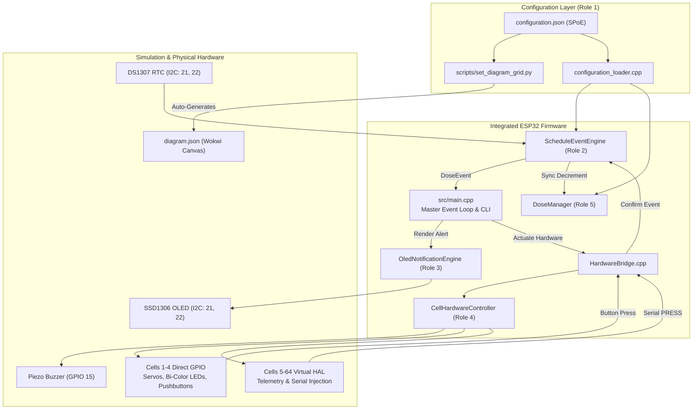
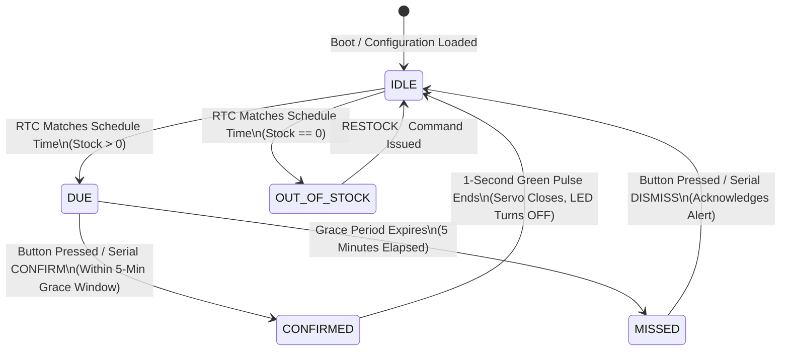

# Smart Medicine Reminder & Dispensing Workstation

[](https://platformio.org/)
[-brightgreen.svg)](test/run_all_tests.sh)
[](docs/system_integration.md)
[](LICENSE)

An intelligent, scalable IoT medication adherence and dispensing workstation engineered on the **ESP32 DevKit V1**. The system combines Real-Time Clock (RTC) precision scheduling, multi-sensory patient alerting (OLED display, bi-color LEDs, piezo buzzer), automated compartment servo actuation, and a digital inventory management ledger with empty-stock safety locks.

---

## Team & Role Allocation

This project was engineered through a modular, domain-driven architecture divided among 5 specialized roles and unified through a master system integration lead:

| Role | Domain / Module | Team Member | GitHub Profile | Primary Responsibilities |
| :--- | :--- | :--- | :--- | :--- |
| **Role 1** | **Medicine & Cell Data** | **Nevin Beno** | [@nevinbeno](https://github.com/nevinbeno) | Single Point of Entry (`configuration.json`), flash-embedded data loader, SQLite schema. |
| **Role 2** | **Scheduling & Event Engine** | **Gabriel** | [@gabriel22dec](https://github.com/gabriel22dec) | DS1307 RTC timekeeping, simultaneous dose triggers, grace period (5 min), midnight rollover. |
| **Role 3** | **OLED UI & Notifications** | **Meera** | [@meeralavender](https://github.com/meeralavender) | SSD1306 128x64 OLED display, non-blocking UI, idle clock screen, 1.8s multi-alert rotation. |
| **Role 4** | **Hardware & Alert Control** | **Pavithra** | [@Pavithra-S-hub](https://github.com/Pavithra-S-hub) | Dedicated GPIOs (Cells 1–4), Virtual Expander HAL (Cells 5–64), Wokwi canvas generator. |
| **Role 5** | **Dose & Stock Management** | **Abhiram H** | [@abhiramh3482](https://github.com/abhiramh3482) | Dose inventory ledger, zero-stock dispense guard, low-stock alerts, refill API. |
| **Role 6** | **Integration & Final Docs** | **Maria Catherine** | [@mariacatheriine](https://github.com/mariacatheriine) | Master orchestrator (`main.cpp`), `HardwareBridge` latches, Serial CLI, master test suite. |

---

## System Architecture



### Compartment Lifecycle State Machine



---

## Hardware Pinout (ESP32 DevKit V1)

Physical pins are mapped to the primary 4 compartments (Cells 1–4). Higher-capacity matrices (up to 8x8 / 64 compartments) scale seamlessly through the **Virtual Expander HAL**, avoiding GPIO pin exhaustion and PWM timer limits.

| Compartment | Red LED (DUE) | Green LED (CONFIRMED) | Push Button | SG90 Servo Motor | Description |
| :---: | :---: | :---: | :---: | :---: | :--- |
| **Cell 1** | `GPIO 25` | `GPIO 26` | `GPIO 32` | `GPIO 18` | Physical Compartment 1 |
| **Cell 2** | `GPIO 14` | `GPIO 16` (RX2) | `GPIO 33` | `GPIO 19` | Physical Compartment 2 |
| **Cell 3** | `GPIO 13` | `GPIO 12` | `GPIO 27` | `GPIO 5`  | Physical Compartment 3 |
| **Cell 4** | `GPIO 4`  | `GPIO 2`  | `GPIO 23` | `GPIO 17` (TX2) | Physical Compartment 4 |
| **Buzzer** | — | — | — | `GPIO 15` | Shared Piezo Alert Buzzer |
| **I2C Bus** | `GPIO 21` (SDA) | `GPIO 22` (SCL) | — | — | SSD1306 OLED & DS1307 RTC |
| **Cells 5–64**| *Virtual* | *Virtual* | `PRESS <id>` | *Virtual* | Virtual Expander HAL |

---

## Key Features

1. **Single Point of Entry (SPoE):**
   - All medication schedules, cell counts, and matrix grid dimensions are configured in one place: [`medicine-cell-data/config/configuration.json`](medicine-cell-data/config/configuration.json).
   - PlatformIO's pre-build script ([`scripts/set_diagram_grid.py`](scripts/set_diagram_grid.py)) automatically updates Wokwi's visual wiring diagram ([`diagram.json`](diagram.json)) on every build.
2. **Flash-Embedded Configuration:**
   - Configuration JSON is compiled directly into ESP32 flash memory (`board_build.embed_txtfiles`), eliminating filesystem (SPIFFS/LittleFS) overhead and startup delays.
3. **Dual Stock Ledgering & Empty Lockout:**
   - Real-time stock tracking inside both `ScheduleEventEngine` and `DoseManager`.
   - If stock reaches 0, the servo door stays locked at 0° (CLOSED), a yellow alert illuminates, and empty dispensing is physically prevented until restocked.
4. **Non-Blocking Multi-Alarm OLED:**
   - 128x64 SSD1306 OLED refreshes asynchronously.
   - When multiple compartments trigger simultaneously, the display smoothly cycles between medications every 1.8 seconds.
5. **Interactive Serial CLI:**
   - Complete control over time, simulated presses, inventory refills, and status inspection directly via the Serial Monitor at `115200` baud.

---

## Interactive Serial CLI Commands

Connect to the Serial Monitor at **115200 baud** to run interactive commands:

| Command | Syntax | Description | Example |
| :--- | :--- | :--- | :--- |
| **STATUS** | `STATUS` | Dumps real-time table of all active cells (Stock, Servos, LEDs, Schedules). | `STATUS` |
| **DUE** | `DUE <cell>` | Manually triggers a cell into the `DUE` state (respects `doseQuantity`). | `DUE 1` |
| **CONFIRM** | `CONFIRM <cell>` | Simulates confirming a dose for an active compartment. | `CONFIRM 1` |
| **PRESS** | `PRESS <cell>` | Simulates pressing the physical pushbutton (works for Cells 1 to 64). | `PRESS 3` |
| **RESTOCK** | `RESTOCK <cell> <qty>` | Replenishes stock for a compartment and clears empty warnings. | `RESTOCK 4 10` |
| **TIME** | `TIME <HH> <MM> [SS]` | Sets the DS1307 simulated Real-Time Clock time. | `TIME 13 37 55` |
| **GRID** | `GRID <rows> <cols>` | Dynamically scales the hardware matrix dimensions (up to 8x8). | `GRID 4 4` |
| **GRACE** | `GRACE <minutes>` | Configures the grace period before an unanswered dose becomes `MISSED`. | `GRACE 10` |

---

## Getting Started & Wokwi Simulation

### Prerequisites
- [VS Code](https://code.visualstudio.com/) with the [PlatformIO IDE Extension](https://marketplace.visualstudio.com/items?itemName=platformio.platformio-ide)
- [Wokwi Simulator Extension](https://marketplace.visualstudio.com/items?itemName=Wokwi.wokwi-vscode)

### Running in VS Code
1. Clone the repository and open the root folder in VS Code:
   ```bash
   git clone https://github.com/nevinbeno/smart-medicine-remainder.git
   cd smart-medicine-remainder
   ```
2. Build the firmware using PlatformIO:
   ```bash
   pio run -e esp32doit-devkit-v1
   ```
3. Open `diagram.json` in VS Code and press the green **Play** button to launch the interactive simulation.
4. Open the Serial Monitor (115200 baud) and type `STATUS` to verify system initialization.

---

## Automated Verification Suite (33 / 33 Tests Passing)

The project includes 33 automated tests with 100% pass rates across three independent suites:

```bash
# Run all 33 unit tests in one command
bash test/run_all_tests.sh
```

### Breakdown of Test Suites
- **Role 5 Dose Manager (`test/test_dose_manager/test_main.cpp`)**: 7/7 tests pass (PlatformIO Unity / Native C++). Verifies stock decrements, empty stock locking, refills, and overflow protection.
- **Role 2 Scheduling Engine (`scheduling-event-engine/test/run_tests.sh`)**: 12/12 tests pass (Standalone C++ runner). Verifies minute matching, simultaneous alarms, grace periods, and midnight rollover.
- **Role 4 Hardware & Matrix HAL (`test/run_hardware_tests.sh`)**: 14/14 test suites pass (Hardware C++ runner). Verifies physical GPIO pins, 1x1 through 8x8 virtual matrix grids, buzzer arbitration, and button debounce.

---

## Detailed Presentation & Defense Guide

For the full slide-by-slide spoken script, live demo walkthrough, and technical Q&A defense answers, consult:
📄 **[PROJECT_GUIDE.md](PROJECT_GUIDE.md)**

---

## Repository Structure

```text
.
├── diagram.json                       # Wokwi canvas schematic (auto-synced)
├── grid_config.json                   # Active matrix grid layout metadata
├── platformio.ini                     # Build environments (ESP32 DevKit V1 & Native Unity)
├── extra_script.py                    # PlatformIO SCons pre-build hook for SPoE auto-sync
├── README.md                          # Official project documentation
├── PROJECT_GUIDE.md                   # Complete presentation script & technical guide
├── medicine-cell-data/                # Role 1: Data Models & SPoE Configuration
│   ├── config/configuration.json      # Master Single Point of Entry configuration
│   ├── database/schema.sql            # Relational SQLite prescription schema
│   ├── include/                       # Runtime configuration & data types
│   └── src/configuration_loader.cpp   # Flash JSON deserializer
├── scheduling-event-engine/           # Role 2: Timekeeping & Scheduling Engine
│   ├── include/                       # ScheduleEventEngine & TimeProvider interfaces
│   ├── src/schedule_event_engine.cpp  # Alarm matching, simultaneous events, grace period
│   └── test/run_tests.sh              # 12-suite standalone scheduler test runner
├── lib/oled-ui-notification-engine/   # Role 3: SSD1306 OLED Display Driver
│   ├── include/                       # OledNotificationEngine interface
│   └── src/oled_notification_engine.cpp # Non-blocking clock, alerts, 1.8s auto-rotation
├── lib/CellHardwareControl/           # Role 4: Physical Actuators & Virtual Expander HAL
│   ├── src/CellHardwareController.cpp # Master hardware arbitrator & state machine
│   ├── src/CellActuators.cpp          # SG90 Servos & Bi-Color LED drivers
│   └── src/HardwareConfig.h           # Physical GPIO pin allocations
├── include/dose_manager.h             # Role 5: Inventory Ledger & Safety Logic
├── scripts/set_diagram_grid.py        # Automation: Dynamic Wokwi diagram generator
├── src/                               # System Integration (Catherine)
│   ├── main.cpp                       # Master FreeRTOS loop, bootloader, Serial CLI
│   ├── HardwareBridge.cpp             # Event latching & non-reentrant bridge
│   └── HardwareBridge.h               # Hardware bridge definitions
└── test/
    ├── run_all_tests.sh               # Master one-click verification runner (31 tests)
    ├── run_hardware_tests.sh          # Role 4 Hardware & Matrix HAL test runner
    ├── test_cell_hardware/            # Role 4 test cases
    └── test_dose_manager/             # Role 5 native Unity test cases
```
