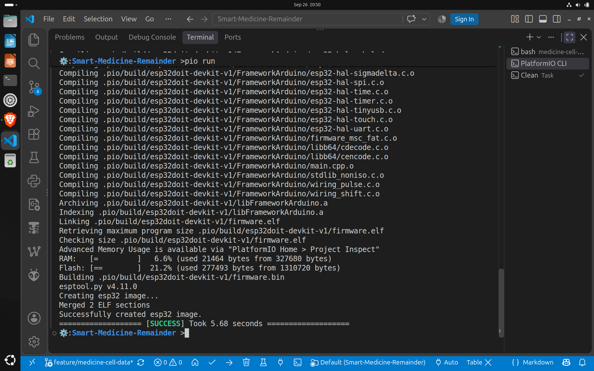

# Medicine & Cell Data Module

## Purpose

The `medicine-cell-data` module defines the data architecture and configuration pipeline
for the Smart Medicine Reminder and Dose Management System.

Its main responsibility is to:

- Define the database structure for medicines, schedules, and cells.
- Provide Python functions to create and manipulate the database data.
- Define relationships between cells, medicines, and schedules.
- Generate a JSON snapshot of the current system configuration.
- Define C++ runtime structures for representing that configuration.
- Load the generated JSON into C++ runtime structures on the ESP32.
- Verify that the configuration can be successfully loaded and accessed by the firmware.

The module does **not** implement the scheduling engine, OLED interface, alert logic,
or dose-confirmation logic.

---

# 1. Overall Configuration Flow

The complete configuration pipeline is:

```text
                    DATABASE / CONFIGURATION SETUP
                              │
                              ▼
                       schema.sql
                              │
                              │ creates structure
                              ▼
                         medicine.db
                              │
                              │
                    Python Backend Layer
                              │
             ┌────────────────┼────────────────┐
             │                │                │
             ▼                ▼                ▼
         medicine.py      schedule.py       cell.py
             │                │                │
             └────────────────┼────────────────┘
                              │
                              ▼
                       relationship.py
                              │
                     combines related data
                              │
                              ▼
                     json_generator.py
                              │
                              ▼
                    configuration.json
                              │
                              │
                    EMBEDDED FIRMWARE
                              │
                              ▼
                     ESP32 / PlatformIO
                              │
                    embedded configuration
                              │
                              ▼
                     main.cpp receives JSON
                              │
                              ▼
                  configuration_loader.cpp
                              │
                       parses JSON
                              │
                              ▼
                    RuntimeConfiguration
                              │
                              ▼
                       Serial Monitor
```
- SQLite is the configuration source, JSON is the configuration snapshot, and RuntimeConfiguration is the C++ representation of that snapshot inside the ESP32.

## 2. Module Structure: 
```txt
       .
       ├── backend
       │   ├── cell.py
       │   ├── database.py
       │   ├── __init__.py
       │   ├── json_generator.py
       │   ├── medicine.py
       │   ├── README.md
       │   ├── relationship.py
       │   └── schedule.py
       |
       ├── config
       │   └── configuration.json
       |
       ├── database
       │   ├── medicine.db
       │   ├── README.md
       │   └── schema.sql
       |
       ├── docs/
       │   ├── architecture.md
       │   └── include.md
       |
       ├── include/
       │   ├── cell.hpp
       │   ├── configuration.hpp
       │   ├── configuration_loader.hpp
       │   ├── medicine.hpp
       │   ├── README.md
       │   └── schedule.hpp
       |
       ├── README.md
       |
       ├── sample/
       │   ├── README.md
       │   └── sample_main.cpp
       |
       ├── src/
       │   ├── cell.cpp
       │   └── configuration_loader.cpp
       |
       └── test/
           ├── __init__.py
           ├── README.md
           ├── test_cell.py
           ├── test_medicine.py
           ├── test_relationship.py
           └── test_schedule.py

```

## 3. Database Layer
- The database layer defines the persistent configuration data.
- Refer [database documentation](database/README.md) for more info.

## 4. Python Backend Layer
- The Python backend provides functions for interacting with the SQLite database.
- Refer [backend documentation](backend/README.md) for more info. 

## 5. Configuration JSON
- It is the generated configuration snapshot.
- The ESP32 does not query SQLite at runtime. We embedd this snapshot into the ESP32. 
## 6. C++ Runtime Data Model
- The C++ headers define how the configuration is represented in ESP32 memory.
- Refer [headers documentation](include/README.md) for more info. 
## 7. JSON to C++ Loading
- The relationship between the configuration model and the loader is:
```txt
       configuration.json
              │
              │ JSON data
              ▼
       configuration_loader.cpp
              │
              │ parses and extracts
              ▼
       RuntimeConfiguration
              ▲
              │
              │ structure defined by
              │
       configuration.hpp
```
- The loader uses ArduinoJson to parse the JSON and populate RuntimeConfiguration
## 8. ESP32 Firmware Integration
- The module's C++ source files are outside the normal root src/ directory. Therefore PlatformIO needs additional build configuration.

## 9. PlatformIO Configuration
- The root/`platformio.ini` contains the build configuration required by this module.
- Important additions include:
       - ArduinoJson dependency (provides the JSON parsing library)
       - Custom build script (tells PlatformIO to execute extra_script.py before the normal build)
       - Embedding the configuration (This embeds the generated JSON into the ESP32 firmware image)

## 10. `extra_script.py`
- `extra_script.py` extends PlatformIO's build process.
- It performs two important tasks:
       - Adds ArduinoJson include paths
       - Compiles the module's external C++ sources

- The script explicitly asks PlatformIO to build the external C++ sources.
- Therefore the final firmware contains the implementation of the module.

## 11. Testing
- The Python tests verify the backend and database layer.
## 12. Complete End-to-End Flow
- The complete process can be summarized as:
```txt
       1. schema.sql
              │
              ▼
       2. medicine.db
              │
              ▼
       3. Python backend
       ├── medicine.py
       ├── schedule.py
       ├── cell.py
       └── relationship.py
              │
              ▼
       4. json_generator.py
              │
              ▼
       5. configuration.json
              │
              │ embedded by PlatformIO
              ▼
       6. ESP32 firmware
              │
              ▼
       7. main.cpp
              │
              ▼
       8. loadConfiguration()
              │
              │ implemented in
              ▼
       9. configuration_loader.cpp
              │
              ▼
       10. RuntimeConfiguration
              │
              │ defined in
              ▼
       11. configuration.hpp
              │
              ▼
       12. Serial Monitor
```

- The successful result demonstrates:

```txt
       SQLite
       ↓
       Python
       ↓
       JSON
       ↓
       ESP32 firmware
       ↓
       ArduinoJson
       ↓
       C++ runtime structures
       ↓
       Serial Monitor
```

## 13. Build
- Run
```bash
pio run
```
- Output: 
<div align="center">
       </img>
</div>

## 14. Output of the Final Test on ESP32: 
```txt
       ets Jul 29 2019 12:21:46

       rst:0x1 (POWERON_RESET),boot:0x13 (SPI_FAST_FLASH_BOOT)
       configsip: 0, SPIWP:0xee
       clk_drv:0x00,q_drv:0x00,d_drv:0x00,cs0_drv:0x00,hd_drv:0x00,wp_drv:0x00
       mode:DIO, clock div:2
       load:0x3fff0030,len:1156
       load:0x40078000,len:11456
       ho 0 tail 12 room 4
       load:0x40080400,len:2972
       entry 0x400805dc

       ================================
       SMART MEDICINE CONFIGURATION
       ================================
       Configuration loaded successfully!

       Cell count: 4

       ----------------------------
       Cell ID: CELL01
       State: OCCUPIED
       Current stock: 20
       Medicine ID: MED001
       Medicine name: Paracetamol
       Low-stock threshold: 3
       Schedule count: 2
       08:00 -> dose 1
       20:00 -> dose 1
       ----------------------------
       Cell ID: CELL02
       State: OCCUPIED
       Current stock: 10
       Medicine ID: MED002
       Medicine name: Cetirizine
       Low-stock threshold: 2
       Schedule count: 1
       22:00 -> dose 1
       ----------------------------
       Cell ID: CELL03
       State: OCCUPIED
       Current stock: 15
       Medicine ID: MED003
       Medicine name: Amoxicillin
       Low-stock threshold: 3
       Schedule count: 2
       13:00 -> dose 1
       22:00 -> dose 1
       ----------------------------
       Cell ID: CELL04
       State: OCCUPIED
       Current stock: 8
       Medicine ID: MED004
       Medicine name: Pantocid
       Low-stock threshold: 3
       Schedule count: 1
       07:00 -> dose 1

       ================================
       Configuration test completed
       ================================

```