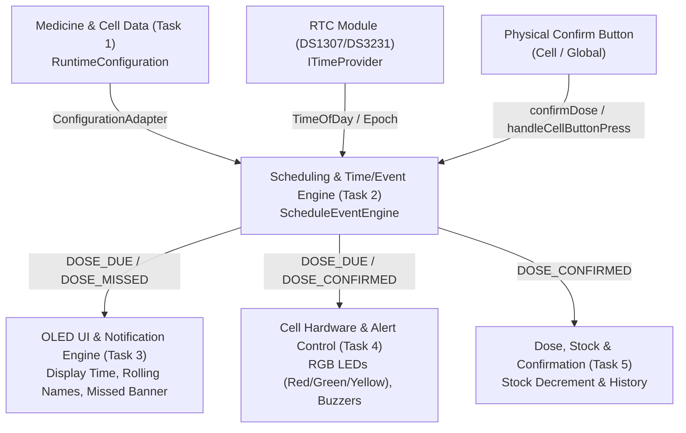
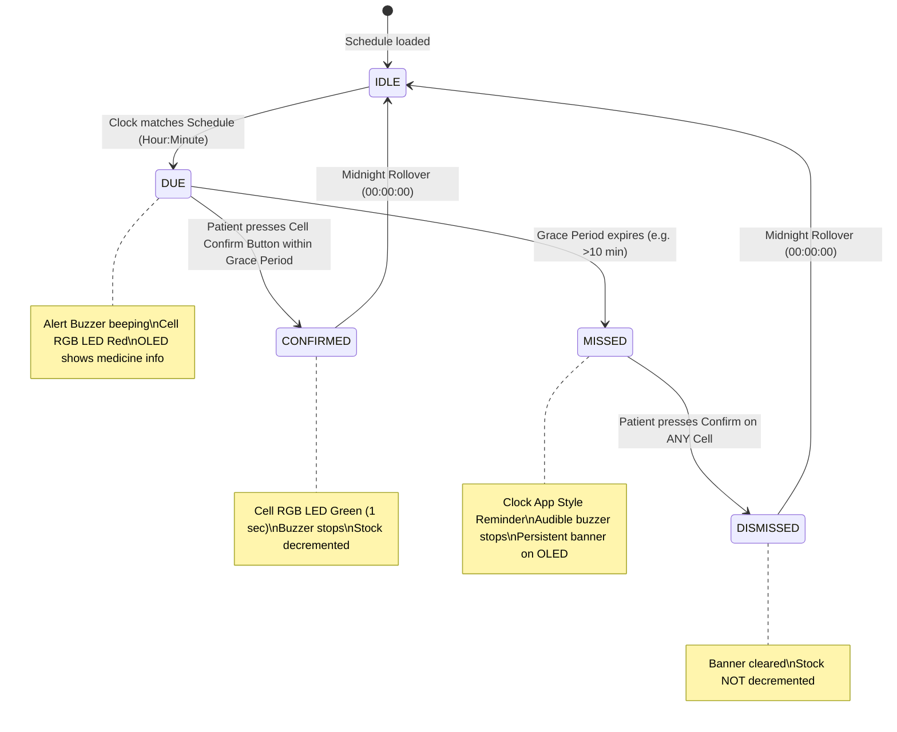

# Scheduling & Time/Event Engine Architecture

## 1. Overview
The **Scheduling & Time/Event Engine** is the central temporal coordinator of the Smart Medicine Reminder and Dose Management System. It continuously compares the real-time clock (RTC) with active medication schedules, evaluates temporal conditions, detects simultaneous doses, and transitions events through an explicit lifecycle.

---

## 2. System Position & Interactions
The engine acts as the core hub connecting configuration data with presentation and actuation modules:

---

## 3. Dose Event State Machine

Every scheduled dose adheres to a deterministic finite state machine (FSM):

---

## 4. Key Subsystems & Design Choices

### 4.1. Hardware-Independent Time Abstraction (`ITimeProvider`)
To decouple the business logic from specific microcontrollers and hardware RTC buses, time querying is abstracted behind the `ITimeProvider` interface:
- **`RTCTimeProvider`**: Interfaces with physical I2C RTC chips (DS1307 / DS3231) via Adafruit RTClib.
- **`SimulatedTimeProvider`**: Fully deterministic time generator enabling automated fast-forwarding, edge-case simulation, and rapid unit testing without physical hardware.

### 4.2. Handling Simultaneous Schedules
When multiple medicines share the same scheduled timestamp (e.g. Paracetamol in Cell 1 and Amoxicillin in Cell 3 both due at 08:00):
1. **Parallel Event Generation**: The engine triggers an individual `DOSE_DUE` event for every matching compartment.
2. **Active Queue**: Both events are tracked concurrently in `activeDueEvents[]`.
3. **UI Notification**: The OLED UI engine polls `getDueEventCount()` and rolls through medicine names sequentially.
4. **Hardware Alerts**: All matching compartment LEDs are turned RED, and the shared alert buzzer beeps until all doses are confirmed or transition to missed.

### 4.3. Missed Dose Handling (Mobile Clock App Logic)
In traditional systems, missed doses either lock the system or cause invalid stock updates. The Smart Medicine Reminder implements a user-friendly "Clock App" paradigm:
1. **Grace Period**: Configurable alert duration (default 5–10 minutes) during which audible beeping and red LEDs persist.
2. **Timeout Transition**: Once the grace period elapses, the event transitions to `EventState::MISSED`. The loud buzzer stops to avoid nuisance, but a persistent reminder banner remains on the OLED.
3. **Non-destructive Dismissal**: When the patient acknowledges the reminder by pressing any confirm button:
   - The notification banner is cleared (`DOSE_DISMISSED`).
   - **Crucially, medicine stock is NOT decremented**, because the medicine was not taken on schedule, maintaining accurate inventory counts.

### 4.4. Midnight Rollover & Daily Refresh
Daily medication regimens require automatic cycle resets:
- The engine checks for hour rollbacks (e.g. 23:59:59 to 00:00:00).
- Upon detecting rollover, all `triggeredToday` flags are set to `false`.
- An `EventType::DAILY_RESET` event is emitted.

### 4.5. Embedded Memory Constraints
- **Zero Heap Fragmentation**: The engine avoids dynamic `new`/`malloc` inside runtime loops (`update()`). All queues and arrays use bounded static storage (`MAX_ACTIVE_EVENTS`, `MAX_ENGINE_CELLS`).
- **Deterministic Latency**: Constant execution time ($O(N)$ with respect to configured cells), ensuring real-time responsiveness on the ESP32.

---

## 5. Scalability Model
The engine is structured to support scaling from single-compartment pillboxes to large multi-cell dispensers:

| Tier | Configuration | Cells | Use Case |
|---|---|---|---|
| **Tier 1** | 1 Cell | 1 | Single medication reminder |
| **Tier 2** | 2x2 Matrix | 4 | Morning / Noon / Evening / Night dispenser |
| **Tier 3** | 4x4 Matrix | 16 | Multi-patient or 14-day schedule organizer |
| **Tier 4** | 8x8 Matrix | 64 | Hospital ward medicine dispensary |

The engine accepts `-DMAX_ENGINE_CELLS=N` at compile-time to adjust memory footprint dynamically.
